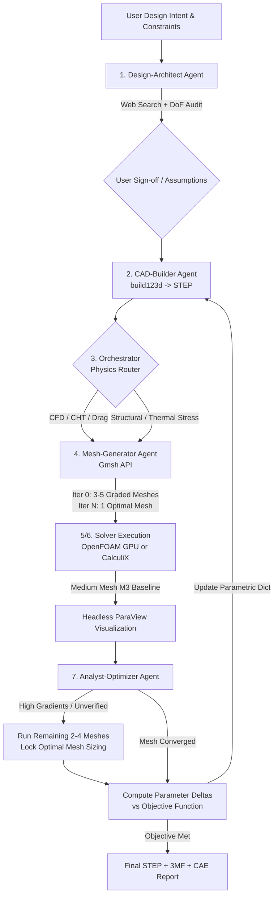

# Autonomous-CAE: Autonomous CAD, CFD & FEM Optimization Framework

[](https://www.python.org/downloads/)
[-orange)](https://github.com/gumyr/build123d)
[-00a1e0)](https://www.openfoam.com/)
[](http://www.dhondt.de/)
[](https://github.com/langchain-ai/langgraph)
[](https://opensource.org/licenses/MIT)

**Agentic-CAE** is an open-source, multi-agent engineering pipeline that transforms natural language design intent into validated, physics-optimized, 3D-printable B-rep CAD models. 

By bridging **programmatic CAD (`build123d`)**, **automated multi-fidelity meshing (`Gmsh`)**, **GPU-accelerated CFD (`OpenFOAM`)**, **structural/thermal FEA (`CalculiX`)**, and **headless scientific visualization (`ParaView`)**, the framework executes closed-loop design iterations—operating either with **Human-in-the-Loop (HITL) engineering sign-offs** at every transition or in **fully autonomous optimization mode**.

---

## Key Features

- **Intent-to-Specification with DoF Auditing:** Researches existing engineering topologies via web search, identifies unconstrained Degrees of Freedom (DoF), consults the user, or logs explicit, physically grounded assumptions.
- **True Parametric B-Rep Geometry:** Generates clean Python `build123d` scripts and exports analytical `STEP` files (not broken meshes) ready for downstream enterprise CAD (Siemens NX, SolidWorks, FreeCAD) or `STL`/`3MF` slicing.
- **Automated Physics Routing:** Dynamically selects between **OpenFOAM** (fluid dynamics, pressure drop, conjugate heat transfer), **CalculiX** (linear/non-linear structural stress, deformation, solid thermal conduction), or coupled workflows.
- **Adaptive Mesh Sensitivity Analysis (GCI):** Generates 3–5 graded meshes (`Coarse` to `Ultrafine`), executes a baseline pass on the medium mesh, and autonomously determines if a multi-mesh **Grid Convergence Index (GCI)** study is required before locking in optimal element sizing for subsequent geometry loops.
- **Headless Visual Diagnostics:** Automatically renders 2D slice planes and 3D contour plots via `pvbatch` (ParaView) and `PyVista` after baseline runs.
- **Toggleable Autonomy:** Start with interactive step-by-step confirmation (`--hitl`) and switch to unattended multi-iteration optimization (`--autonomous`) with a single flag.

---

## System Architecture & Workflow



---

## The Multi-Agent Roster

| Agent | Responsibility | Core Tooling |
| :--- | :--- | :--- |
| **`Orchestrator`** | Manages LangGraph state transitions, routes physics domains, and enforces Human-in-the-Loop gates. | `LangGraph`, `Rich CLI` |
| **`Design-Architect`** | Researches empirical engineering designs, resolves missing Degrees of Freedom, and defines parametric bounds. | `Web Search`, `Claude API` |
| **`CAD-Builder`** | Writes modular `build123d` code, tags boundary faces, verifies manifold topology, and exports `.step` files. | `build123d`, `OpenCASCADE` |
| **`Mesh-Generator`** | Builds 3–5 graded meshes for initial sensitivity checks and single locked-fidelity meshes during optimization. | `Gmsh Python API` |
| **`CFD-Solver`** | Configures OpenFOAM dictionaries, maps boundary patches, executes GPU-offloaded solvers, and monitors residuals. | `OpenFOAM`, `PETSc/AmgX` |
| **`FEM-Solver`** | Builds CalculiX `.inp` decks for static stress, buckling, and thermo-mechanical steps; parses `.frd` results. | `CalculiX (ccx)` |
| **`Analyst-Optimizer`** | Runs `pvbatch` renders, evaluates Grid Convergence Index (GCI), and computes new geometric parameter updates. | `ParaView`, `PyVista`, `SciPy` |

---

## Tech Stack

* **AI & Orchestration:** Claude (Anthropic API / Claude Code subagents), LangGraph, Pydantic
* **Parametric CAD Kernel:** `build123d` (OpenCASCADE B-Rep kernel)
* **Mesh Generation:** `Gmsh` (2nd-order Tetrahedral `C3D10` for FEM; Hex-dominant / Prism layers for CFD)
* **CFD & Conjugate Heat Transfer:** `OpenFOAM` (containerized with NVIDIA GPU linear solver support)
* **Structural & Thermal FEA:** `CalculiX` (`ccx`)
* **Post-Processing & Visualization:** `ParaView` (`pvbatch` headless OSMesa) & `PyVista`

---

## Getting Started

### Prerequisites
1. **Docker & Docker Compose** (with [NVIDIA Container Toolkit](https://docs.nvidia.com/datacenter/cloud-native/container-toolkit/install-guide.html) installed for GPU-accelerated OpenFOAM runs).
2. **Python 3.11+** and `uv` or `poetry`.
3. **Anthropic API Key** (`ANTHROPIC_API_KEY`) or **Claude Code CLI**.

### Installation

```bash
# 1. Clone the repository
git clone [https://github.com/YOUR_USERNAME/agentic-cae.git](https://github.com/YOUR_USERNAME/agentic-cae.git)
cd agentic-cae

# 2. Install Python dependencies
pip install -e .

# 3. Build and start the GPU-enabled CAE solver container (OpenFOAM + CalculiX + Gmsh + ParaView)
docker compose -f docker/docker-compose.yml up -d --build
```

### Usage

#### Interactive Mode (Human-in-the-Loop at Every Step)
By default, the pipeline pauses between every agent transition to present engineering assumptions, CAD previews, mesh metrics, and ParaView plots for your approval:

```bash
python main.py --hitl --prompt "Design a 1-to-3 fluid distribution manifold within a 150x100x60mm envelope. 20mm inlet, three 10mm outlets. Minimize pressure drop and equalize mass flow split at 15 L/min water."
```

#### Autonomous Mode (Closed-Loop Optimization)
Once your initial design constraints are locked in, allow the framework to iterate autonomously until convergence criteria or `MAX_OPT_ITERATIONS` are reached:

```bash
python main.py --autonomous --max-iterations 10 --resume-session latest
```

---

## Repository Structure

```text
agentic-cae/
├── CLAUDE.md                  # Instructions & context for Claude Code CLI
├── .claude/agents/            # Native Claude Code specialist subagent definitions
├── docker/                    # Dockerfile & Compose with NVIDIA GPU passthrough
├── src/
│   ├── state.py               # Shared EngineeringState Pydantic schema
│   ├── config.py              # HITL toggles, solver tolerances, iteration limits
│   ├── graph.py               # LangGraph state machine definition
│   ├── agents/                # Specialist agent node logic
│   └── tools/                 # Wrappers for build123d, Gmsh, Docker solvers & ParaView
├── workspace/                 # Runtime outputs (STEP files, meshes, solver cases, PNGs)
├── pyproject.toml
└── main.py
```

---

## Roadmap

- [x] Parametric B-rep generation (`build123d`) with topological face tagging
- [x] Automated 3–5 mesh suite generation & Grid Convergence Index (GCI) evaluator
- [x] OpenFOAM CFD & CalculiX Structural/Thermal execution pipelines
- [ ] Coupled Fluid-Structure Interaction (FSI) & CHT mapping via `preCICE`
- [ ] Surrogate modeling (Gaussian Process / Bayesian Optimization) for high-dimensional parameter spaces
- [ ] Direct slicer CLI integration (`PrusaSlicer` / `OrcaSlicer`) for print-orientation-aware anisotropic stress checks

## License

Distributed under the MIT License. See `LICENSE` for more information.
